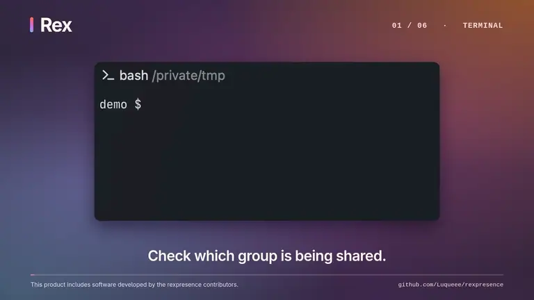

# rexpresence

[](https://github.com/Luqueee/rexpresence/actions/workflows/ci.yml)

Show your active [Rex](https://www.superlogical.com/rex) tool and group on your Discord profile. For example, friends see **Shell · Group: Demo Project**. They don't see your terminal title, paths, or command arguments.

## Demo

[](docs/demo/rexpresence.mp4)

[Download the full demo (MP4, 1080p, 23 seconds)](https://github.com/Luqueee/rexpresence/raw/refs/heads/main/docs/demo/rexpresence.mp4).

## Quick start

**1. Install rexpresence.** Choose your platform:

**macOS (Homebrew):**

```sh
brew install luqueee/tap/rexpresence
```

**Windows x64 (PowerShell):**

```powershell
irm https://raw.githubusercontent.com/Luqueee/rexpresence/main/scripts/install.ps1 | iex
```

**Linux, or macOS without Homebrew** (ARM64 or x86-64):

```sh
curl -fsSL --proto '=https' https://github.com/Luqueee/rexpresence/releases/latest/download/install.sh | sh
```

Prefer to install manually? Download your binary and its checksum from [GitHub Releases](https://github.com/Luqueee/rexpresence/releases).

**2. Start sharing.** Open the Discord desktop app and a terminal in Rex. Then run:

```sh
rexpresence -d
```

Running `rexpresence -d` starts the watcher in the background and returns to your prompt. Run it again at any time: it reports if the watcher is already running. Running `rexpresence` with no arguments lists the commands. Use `rexpresence status` to check the watcher. To run it in the foreground instead (to see errors), use `rexpresence run`; stop it with `Ctrl+C`.

On macOS, rexpresence finds the CLI inside Rex.app and follows the group you select. On Linux and Windows, put `rex` on your `PATH`. You don't need to create a Discord application.

**3. Add the Rex menu (optional).** Run `rexpresence setup` in another terminal and type `yes` to confirm. Open Rex's command palette in your local Mac session and search for `Discord`.

## Control what you share

- **Pause or resume:** choose **Discord: Change Presence… → Pause for 15 minutes**. Sharing resumes automatically, or you can choose **Resume now**.
- **Keep a group private:** the group name is public by default. Choose **Don't share this group** to hide the entire activity for that session, even if you rename it.
- **Show your own message:** choose **Custom public text** instead of showing the tool and group.
- **Edit the card:** open **Discord: Configure Card…** to change the text, logo, or timer. Preview the result, then choose **Apply change**.

You can also use the terminal:

```sh
rexpresence pause 30m    # hide your activity for 30 minutes
rexpresence resume       # end a timed pause early
rexpresence status       # see what the watcher is doing
```

## Common tasks

- **Start at login (macOS):** run `rexpresence install`. To stop the login service and disable login startup, run `rexpresence uninstall`.
- **Update:** run `rexpresence update`, restart the watcher, and rerun `rexpresence setup` if you use the Rex menu.
- **Nothing on Discord?** Keep both desktop apps open. Run `rexpresence doctor` to check the connections, then `rexpresence status` to see whether Discord accepted the activity.
- **Command not found?** The shell installer puts the binary at `~/.local/bin/rexpresence`. On Windows, the installer uses `%LOCALAPPDATA%\Programs\rexpresence\rexpresence.exe`.
- **Homebrew warns about `PATH` shadowing?** Another copy may run first. Use `"$(brew --prefix rexpresence)/bin/rexpresence" doctor` to check which one your shell selects.

<details>
<summary>Advanced: sessions, privacy, and card settings</summary>

**Choose a session.** Run `rexpresence -session NAME` to pin one group. For a remote server, add `-server HOST` using the same host as `rex -S HOST ls`. Add `-project "My project"` only if you want to share that alias publicly.

**Privacy from the CLI.** Find the session ID with `rex ls --json`. Run `rexpresence group hide SESSION_ID` to hide it, `group get SESSION_ID` to check, or `group show SESSION_ID` to allow it again. Allowing a group does not end a pause. These settings belong to your OS account and survive restarts.

**Sharing modes.** Use `rexpresence mode custom "Reviewing a pull request"` for public text, `rexpresence mode paused` for an indefinite pause, or `rexpresence mode auto` to show the tool and group again. `rexpresence pause` defaults to 15 minutes; `rexpresence mode remaining` reports the time left.

**Card fields.** Use `rexpresence card get FIELD`, `card set FIELD VALUE`, or `card reset FIELD` with `line1`, `line2`, `logo`, or `timer`. Text templates support `{tool}`, `{group}`, `{project}`, and `{activity}`. For example, `rexpresence card preview line2 'In {group}'` previews a change without publishing it. A preview needs a running watcher.

**Logo and app name.** The [Rex icon](https://www.superlogical.com/rex-icon.png) is the default. Use `-logo` with a public HTTPS image URL or a Discord art asset key. Discord controls the app name; use `-client-id` or `DISCORD_CLIENT_ID` to select your own application.

**Remove the menu.** Run `rexpresence setup remove`. This leaves the watcher and login service alone. For a symlinked Rex config, set `REX_CONFIG` to the real file before running setup. For a manual setup or a release through v0.2.0, remove the unmarked `require("rexpresence")` from your Rex config yourself.

</details>

## Development

Build with `go build -o rexpresence ./cmd/rexpresence` and run the tests with `go test ./tests`. See [Contributing](CONTRIBUTING.md) for prerequisites, checks, and releases.

## License and attribution

[BSD-4-Clause](LICENSE). This product includes software developed by the rexpresence contributors. This is an independent integration, not an official Rex or Discord product. The license does not grant rights to third-party icons or trademarks.
